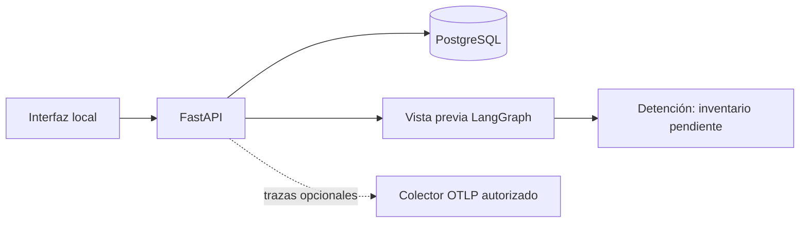
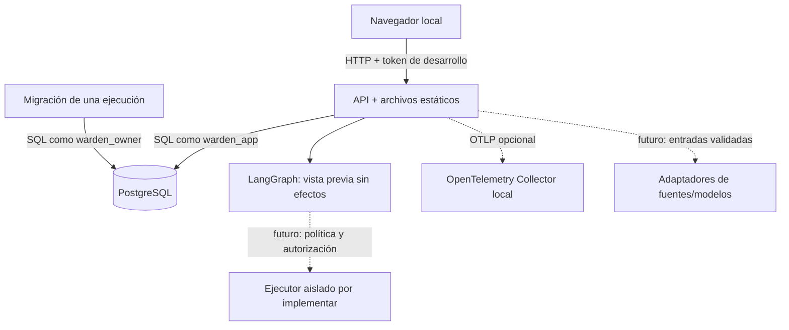

# Arquitectura del scaffold

## Decisiones iniciales

Una aplicación Python sirve la API y los archivos estáticos desde el mismo origen. Esto evita un segundo servidor de frontend, CORS y una cadena de compilación adicional mientras se implementa el flujo principal. FastAPI publica los contratos OpenAPI; Pydantic valida las entradas y psycopg ejecuta SQL parametrizado sobre PostgreSQL. No se añade ORM.

El ecosistema **analizado** sigue siendo Node.js/npm aunque el backend esté escrito en Python. La selección de Python permite utilizar LangGraph directamente y no amplía el alcance a repositorios Python.

La UI agrupa la investigación y respuesta en un centro de operaciones. Evidencia, exposición, plan/parche, validaciones y aprobación pertenecen al mismo contexto de caso; no deben requerir reunir información desde menús independientes. Aplicaciones e inventario, integraciones y configuración conservan espacios propios por su propósito. Esta organización responde a la indicación del usuario de consolidar información y mostrar la respuesta como flujo.

Los componentes se separan por responsabilidad dentro de un único paquete. No hay ocho servicios para los ocho agentes: las etapas del SRS se incorporarán al grafo conforme existan adaptadores y permisos comprobados.

## Límites entre módulos

| Módulo | Responsabilidad actual | Extensión prevista por el SRS |
|---|---|---|
| `main.py` | HTTP, validación, autenticación local, respuestas y estáticos. | Dividir routers por dominio cuando existan más operaciones. |
| `models.py` | Contratos Pydantic de aplicaciones y avisos. | Contratos de inventario, evidencia, hallazgos, planes y aprobaciones. |
| `repository.py` | SQL parametrizado y auditoría transaccional de altas. | Repositorios de las entidades nuevas, sin lógica de proveedores. |
| `db.py` | Conexiones y migraciones con huella/bloqueo. | Pool cuando la carga lo justifique; migraciones siempre separadas del runtime. |
| `integrations.py` | Catálogo de contratos y presencia de configuración sin devolver secretos. | Versiones de contratos y estado de comprobación real. |
| `adapters.py` | Rechazo explícito de conectores no implementados. | Llamadas acotadas a proveedores y normalización de sus resultados. |
| `workflow.py` | Grafo inicial de dos nodos con detención segura. | Etapas completas, políticas, checkpoints y reanudación. |
| `observability.py` | Trazas HTTP y exportación opcional. | Correlación de investigación/etapa, consumo y métricas operativas. |

Los adaptadores obtendrán datos; el motor de correlación deberá comparar versiones de forma determinista; los modelos podrán proponer explicaciones y cambios. Estas responsabilidades no se sustituyen entre sí. Las decisiones de autorización y los efectos de escritura pertenecen a servicios controlados, no al texto que genere un modelo.

## Persistencia y preparación del dominio

- `applications`: nombre, repositorio GitHub y ecosistema npm.
- `investigations`: aviso manual, URL de origen, descripción y aplicación relacionada.
- `audit_events`: alta de aplicaciones y avisos en la misma transacción.
- `schema_migrations`: nombre y huella de migraciones aplicadas.

La segunda migración prepara `inventory_snapshots`, `components`, `deployments`, `advisories`, `advisory_revisions`, `evidence`, `findings`, `remediation_plans`, `patches`, `validation_runs`, `approvals` y `workflow_runs`. Son tablas vacías sin rutas ni agentes operativos todavía. La primera migración se conserva para no invalidar su huella en bases existentes.

Los inventarios y las revisiones de avisos preservan procedencia e historial. Los hallazgos relacionan el componente y la revisión exacta que se evaluó. Parches y validaciones conservan commits y huellas; las aprobaciones conservan el artefacto al que se refieren. La lógica que comprueba coherencia entre aplicaciones, invalida aprobaciones y gestiona el ciclo completo se implementará con sus servicios correspondientes.

No se descargan URLs introducidas por el usuario. Las fuentes se guardan como referencias. No existe todavía una consulta externa, clonado ni ejecución de repositorios.

## Arquitectura de ejecución

PostgreSQL y el migrador comparten una red interna. La API añade una red de servicios para fuentes y observabilidad y publica su puerto en localhost. El archivo opcional `compose.dev.yaml` añade acceso a PostgreSQL desde localhost para desarrollar con Uvicorn fuera de Docker. La imagen no incluye `.env`, secretos ni el código de los proyectos a analizar. Las claves externas se entregan en ejecución y no activan capacidades pendientes.

`warden_app` no puede modificar la bitácora existente ni escribir migraciones. El migrador tiene otra credencial y no atiende peticiones HTTP. Esta separación no implementa aún permisos por usuario/proyecto; el token compartido solo cubre el entorno local de desarrollo.

## Estado, tareas y aislamiento

El único flujo ejecutable termina en `inventory_gate` con `requires_intervention`. No escribe checkpoints ni modifica el estado del aviso. `workflow_runs` prepara un registro de dominio, pero no se presenta como mecanismo de recuperación del grafo.

Cuando se implemente el procesamiento real, el orquestador deberá persistir cada transición, añadir un checkpointer PostgreSQL soportado por LangGraph y separar operaciones largas de las solicitudes HTTP. La elección de un worker o una cola adicional requiere una necesidad concreta; no se incorpora Redis ni otro servicio por defecto.

El contenedor de la API se ejecuta sin privilegios y con raíz de solo lectura. Eso no basta para ejecutar paquetes no confiables: el ejecutor futuro necesitará trabajos efímeros, límites, control de red, herramientas permitidas, artefactos y cancelación. El socket Docker y las credenciales de escritura de GitHub no se entregarán al código analizado.

## Relación con el WBS

| Paquete | Avance aportado por el scaffold | Pendiente para cerrarlo |
|---|---|---|
| 1.1.2 | Inventario de integraciones y ficha de contrato. | Verificación de APIs, licencias de datos, cuotas y accesos reales, especialmente Meterless. |
| 1.2.1 | Paquete Python, entorno Docker, archivo de bloqueo y CI. | Consolidar evidencia de construcción y arranque en el registro de verificación. |
| 1.2.2 | Migraciones iniciales de dominio y persistencia de aplicaciones/avisos. | Operaciones de inventario, evidencia, hallazgo, parche, validaciones y aprobaciones. |
| 1.2.3 | Token local de desarrollo y secretos en variables. | Identidades individuales, roles y autorización por ámbito. |
| 1.3.1 | Registro de nombre y repositorio. | Autorización y extracción de un commit real. |
| 1.5.1 | Grafo compilado con una puerta que detiene la vista previa. | Estados del flujo completo, checkpoints PostgreSQL y reanudación. |
| 1.9 | Pantalla inicial, acceso por token y formularios de aplicaciones/avisos. | Flujos completos de evidencia, exposición, diff, aprobación y reporte. |
| 1.10.1 | Instrumentación de solicitudes, exportación OTLP y colector local opcional. | Trazas por investigación/etapa, métricas de conectores y consumo. |

Ningún paquete del WBS se considera cerrado únicamente por tener carpetas o archivos iniciales.

## Siguiente incremento recomendado

1. Verificar el contrato real de Meterless y permisos GitHub.
2. Implementar contratos y operaciones sobre las tablas de inventario, componentes, evidencia y despliegue ya preparadas.
3. Conectar lectura de repositorio y Syft sobre un commit de prueba autorizado.
4. Implementar OSV y las demás fuentes bajo el contrato documentado.
5. Incorporar correlación determinista antes de permitir planificación o generación de cambios.

