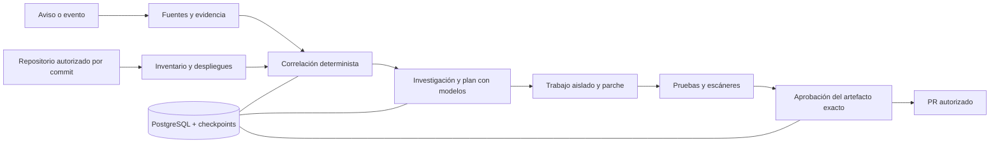

# Aseguramiento de factibilidad — MVP ALAIRA Warden

| Campo | Valor |
|---|---|
| Revisión | 1.0, 26 de octubre de 2026, Costa Rica |
| Objetivo confirmado | Entregar el MVP completo del SRS al Open Agent Hackathon 2026 |
| Fecha límite consultada | 27 de octubre de 2026, 23:45 UTC / 17:45 Costa Rica |
| Tipo de evaluación | Inspección de código, pruebas de infraestructura/persistencia y consultas públicas reales; documentación de proveedores |
| Dictamen | **Factibilidad técnica condicionada. Objetivo completo conservado; plazo de riesgo alto y dependencias externas aún no aseguradas.** |

## 1. Conclusión ejecutiva

La arquitectura actual permite avanzar sin una reescritura general. API y UI en un solo origen, PostgreSQL transaccional, migraciones separadas, LangGraph y Docker son una base razonable para una organización y un ecosistema npm. La infraestructura se ejecutó; la mayor incertidumbre pertenece al producto que falta construir y a los accesos de patrocinadores.

La entrega completa sigue siendo la meta por instrucción del solicitante. No se cambia el alcance obligatorio del SRS ni se sustituye por un demo reducido. Esta evaluación establece condiciones y pruebas para intentar la entrega completa y distinguirla de una implementación parcial si algún requisito no llega a acreditarse.

La línea base contiene **41 requisitos funcionales marcados MVP, 18 requisitos no funcionales y 13 escenarios de aceptación**. Los cinco requisitos funcionales de Evolución conservan ese alcance; no se incorporan ni se eliminan obligaciones del MVP al evaluar factibilidad.

**No hay una garantía responsable de plazo.** Al comprobar el reloj eran las 23:17 del 26 de octubre en Costa Rica: quedaban aproximadamente 18 horas y 28 minutos. El WBS estima 252–432 horas-persona para el alcance base; no se ha medido el esfuerzo restante ni confirmado capacidad del equipo. Esa estimación no puede transformarse en horas de agentes ni invalidarse solo por generar código más rápido. Como referencia aritmética, cinco personas con 18 horas disponibles suman 90 horas-persona nominales antes de descansos, coordinación y dependencias.

El resultado habilita trabajo de desarrollo con controles. No certifica seguridad de producción, cumplimiento regulatorio, elegibilidad del concurso ni aceptación de los 13 escenarios del SRS.

## 2. Evidencia reunida

### 2.1 Evidencia local

| Prueba o inspección | Resultado | Límite |
|---|---|---|
| API, PostgreSQL y colector en Docker | Entorno activo; imagen reconstruida con las correcciones y API/PostgreSQL saludables. Migrador finalizado con código 0. | Es una comprobación local del scaffold, no de las funciones aún pendientes. Registro en `artifacts/feasibility/build.log`. |
| Suite tras corregir cimientos | **19 pruebas aprobadas**, incluida PostgreSQL real en `warden_test`. | Acredita comportamientos del scaffold; no los escenarios completos del MVP. |
| Permisos efectivos del runtime | La API de prueba registra y consulta datos con `SET LOCAL ROLE warden_app`; intentar modificar auditoría falla por privilegios. | Se prueba autorización PostgreSQL; no existe aún identidad individual ni RBAC por proyecto. |
| Migraciones | Aplicación repetible y comprobación de huellas. Nuevo readiness rechaza migraciones ausentes, cambiadas o inesperadas. | Requiere distribuir los archivos de migración junto a la aplicación y arrancar desde la raíz documentada. |
| Ruff | Análisis y formato comprobados. | No es análisis exhaustivo de seguridad ni prueba del comportamiento. |
| Disponibilidad de herramientas en PATH | Cursor está disponible; Syft, Trivy y OSV-Scanner no se encontraron en PATH. | No se comprobó instalación en otros directorios; la futura imagen del ejecutor debe instalarlos y fijar versiones. |
| Control de versiones | Los archivos del proyecto siguen sin una línea base registrada en un commit al revisar el estado. | Es un riesgo de entrega/reproducibilidad; no se creó ni publicó un commit como parte de esta evaluación. |
| Configuración de patrocinadores/repositorios | La configuración activa del proyecto no tiene credenciales presentes para GitHub, Meterless, NVIDIA o Zetaris. Solo se inspeccionaron indicadores booleanos, sin imprimir valores. | No demuestra que el usuario no tenga accesos en otro lugar. Confirma que no están configurados y verificados aquí. |

### 2.2 Prueba de fuentes públicas

Se ejecutó `python scripts/probe_public_sources.py`. El script solo envía una consulta sintética pública de lodash y solicitudes a catálogos oficiales; no lee credenciales ni transmite código del proyecto. Evidencia: `artifacts/feasibility/public-sources.json`, excluida de Git. Hora del ensayo: 27 de octubre, 05:18 UTC, equivalente a 26 de octubre, 23:18 en Costa Rica.

| Fuente | Operación probada | Respuesta | Resultado observado |
|---|---|---|---|
| OSV | Consulta npm/lodash 4.17.20 | HTTP 200 | JSON con 5 avisos; aproximadamente 0,73 s. |
| GitHub Advisories | Listado público npm, un registro | HTTP 200 | JSON con identificador GHSA; aproximadamente 0,84 s. |
| NVD | Consulta de CVE-2021-23337 | HTTP 200 | Un registro; aproximadamente 0,64 s. |
| CISA KEV | Descarga de catálogo JSON | HTTP 200 | Estructura válida y 1 758 entradas en ese momento; aproximadamente 0,73 s. |

Son mediciones puntuales de conectividad y forma mínima del contrato. No prueban disponibilidad futura, calidad de cobertura, precisión del matching, paginación, cuotas sostenidas o un conector integrado. El catálogo de la aplicación continúa mostrando los adaptadores como no implementados.

## 3. Factibilidad por dimensión

| Dimensión | Dictamen | Fundamento y condición de aseguramiento |
|---|---|---|
| Problema y utilidad | Coherente, pendiente validación con usuario real. | El caso «qué me afecta y cómo responder» es concreto. No existe aún evidencia de ahorro de tiempo frente al proceso manual. |
| Arquitectura base | Apta para continuar el MVP local. | Un monolito modular con SQL reduce operaciones y mantiene una ruta directa de inspección. No hace falta introducir microservicios ni una cola externa antes de demostrar necesidad. |
| Fuentes públicas | Accesibilidad comprobada. | Las cuatro respondieron; falta convertirlas en adaptadores y preservar procedencia, revisiones y limitaciones. |
| Inventario y matching | Viable con límites explícitos. | npm/lockfile y un commit inmutable permiten un alcance concreto. Deben probarse transitivas, prereleases, rangos, alias y casos no soportados. |
| Modelos y Meterless | Condicionada a prueba autenticada. | Hay documentación del proveedor; no se ejecutó una inferencia ni se verificó un runtime concreto. |
| Zetaris | Condicionada a acceso y contrato de la instancia. | Hay API REST documentada; no hay sesión ni consulta real del proyecto. |
| Ejecución y remediación | Riesgo alto, aún no asegurada. | El contenedor endurecido de la API no es un sandbox para dependencias potencialmente hostiles. Requiere otro ejecutor y permisos independientes. |
| UX y consolidación | Estructura preparada. | El caso reúne el flujo completo; los servicios avanzados faltan y la última disposición visual no fue revalidada por bloqueo del navegador. |
| Operación local | Demostrada en el scaffold. | Persistencia, separación de roles SQL, respaldo/restauración y trazas comprobados previamente; readiness y permisos se refuerzan en esta revisión. |
| Costos | No cuantificada todavía. | Sin modelo, cuotas y tamaño de casos definidos no existe estimación monetaria defendible. Necesita presupuesto máximo por caso y periodo. |
| Calendario de entrega completa | Riesgo alto. | Restan integración, seguridad, aceptación y artefactos de entrega en una ventana corta; no se garantiza la fecha. |
| Producción/regulación | No evaluable como aprobada. | Faltan identidades, política de datos, retención y requisitos de despliegue. El objetivo actual es hackathon autorizado. |

## 4. Integraciones críticas: realidad frente a supuestos

### Meterless

La documentación oficial describe motores open source y una opción de Runtime con protocolo compatible con chat completions. Para esa opción, la conexión se acredita consultando modelos con autenticación; el health del proceso por sí solo no demuestra inferencia utilizable. La elección de motor/runtime y versión concreta debe fijarse antes de programar su contrato. Esto mejora la incertidumbre anterior: ya existe una ruta documentada, pero no una integración probada.

**Prueba de salida:** versión y operación elegida, conexión autenticada, una solicitud sintética real, resultado estructurado validado, identidad/modo registrado y fallo comprensible con credencial inválida o servicio caído. Probar datos sintéticos antes de enviar código privado. Un mock sirve para pruebas de error, no como evidencia de uso del patrocinador.

Fuentes: [sitio oficial de Meterless](https://meterless.ai/engines.html), [repositorio oficial](https://github.com/Meterless/Meterless/blob/main/README.md).

### Zetaris

La documentación del proveedor describe acceso REST con URI de instancia y tokens emitidos por su autenticación. Por ello, un único campo genérico `API_KEY` del scaffold no debe interpretarse como contrato confirmado. Deben determinarse edición, URL, autenticación y permisos de consulta de la instancia proporcionada.

**Uso propuesto con valor funcional:** relacionar inventario autorizado y referencias de avisos para devolver al caso una consulta con procedencia. PostgreSQL mantiene el estado operativo; Zetaris no debe introducir un segundo escritor del mismo estado. No se publicará PostgreSQL a Internet para que un proveedor llegue a la máquina local: utilizar fuentes de prueba aprobadas o un enlace soportado.

**Prueba de salida:** consulta autenticada contra al menos dos fuentes autorizadas del escenario, salida identificable y caso de permiso denegado; registrar exactamente qué aportó Zetaris al hallazgo.

Fuente: [API REST oficial de Zetaris](https://kbase.zetaris.com/knowledge/rest-api).

### GitHub y fuentes de vulnerabilidades

El catálogo global de GitHub puede consultarse sin autenticación para recursos públicos. La lectura de repositorios privados y la escritura de ramas/PR tienen otra frontera de permisos. Se corrigió la descripción del scaffold que hacía parecer obligatorio un token para cualquier aviso público.

OSV ofrece comparación por paquete/versión y consulta por lotes; la respuesta por lotes entrega identificadores y exige recuperar detalles cuando hagan falta. Evitar duplicar avisos compartidos entre fuentes o tratar copias del mismo reporte como corroboración independiente. La consulta de malware en GitHub necesita tratar su tipo expresamente: no asumir que el listado predeterminado cubre incidentes de paquetes maliciosos.

Fuentes: [GitHub Global Advisories](https://docs.github.com/en/rest/security-advisories/global-advisories), [OSV Querybatch](https://google.github.io/osv.dev/post-v1-querybatch/).

### NVIDIA y Cursor

NVIDIA documenta inferencia mediante chat completions, pero falta fijar un modelo disponible para esta cuenta y verificar sus condiciones. No se presupone que Meterless encamine automáticamente a NVIDIA. Se puede elegir una integración directa o una ruta intermediada solo cuando esa combinación esté documentada y probada.

Cursor está instalado como herramienta de desarrollo. No demuestra uso efectivo requerido por el concurso ni disponibilidad de una API de automatización del producto. Registrar su contribución de desarrollo; no bloquear el generador de parches detrás de una interfaz programática desconocida.

Fuente: [NVIDIA LLM APIs](https://docs.api.nvidia.com/nim/reference/llm-apis).

### Reglas y fecha del hackathon

La [página oficial del evento](https://hackathon.genai.works/event/open-agent-hackathon-2026) muestra la ventana del 22 al 27 de octubre y cierre el 27 a las 23:45 UTC. También exige Zetaris y Meterless expresamente para Wildcard. El usuario confirma Meterless como obligación del proyecto.

Se encontraron guías/republicaciones con fechas y criterios anteriores; no deben usarse para cambiar el cierre ni asegurar elegibilidad. Para el track principal, confirmar las reglas completas vigentes en el portal y sus entregables antes de declarar opcional Zetaris. Mientras se confirma, se trata su acceso como dependencia crítica preventiva del plan completo, sin modificar silenciosamente la condición del SRS.

**El proyecto no fue registrado, publicado ni enviado al evento desde esta revisión.**

## 5. Hallazgos sobre los cimientos y tratamiento

| ID | Tipo | Evidencia y efecto concreto | Tratamiento |
|---|---|---|---|
| F-01 | Defecto de readiness | Comprobar solo tres tablas permitía declarar lista una aplicación con migraciones pendientes o esquema de otra versión. | **Corregido:** comparar nombres y huellas de todas las migraciones; respuesta 503 ante divergencia. Tres escenarios de regresión y prueba HTTP. |
| F-02 | Brecha de verificación | El roundtrip API de integración usaba al propietario de la base. Podía pasar aunque el runtime careciera de privilegios o tuviera permisos inadecuados. | **Corregido:** operaciones de API bajo `warden_app` y rechazo real de modificación de auditoría. |
| F-03 | Fricción repetible de construcción | `COPY src` precedía a la instalación de dependencias: cambiar una línea de UI invalidaba el cache y repetía descargas/compilación. Se observó en reconstrucciones del scaffold. | **Corregido:** dependencias en una capa anterior al código; construcción del proyecto sin reinstalarlas. Se fija uv 0.11.3 en Docker y CI. |
| F-04 | Supuesto de contrato incorrecto | La descripción GitHub confundía lectura pública de avisos con operaciones autorizadas sobre repositorios. | **Corregido:** documentación del catálogo distingue ambas. |
| F-05 | Funcionalidad pendiente | Fuentes, inventario, matching, parches y aprobaciones aún no existen como servicios. | Mantener en backlog y plan de entrega completa. No contabilizarlo como deuda técnica. |
| F-06 | Riesgo de modelo anticipado | Tablas futuras no garantizan coherencia entre aplicación, snapshot, componente, hallazgo y revisión. Los estados del aviso actual solo admiten dos valores. | Antes de implementar esas escrituras, precisar invariantes y añadir migraciones/contratos; no editar las migraciones ya aplicadas. No se puede declarar interés medido sin esos cambios reales. |
| F-07 | Restricción operativa | Token compartido y actor fijo `local-developer` impiden atribución individual y ámbito por proyecto. | Implementar identidades y autorización antes de marcar RF-35/RF-44 y RNF-01 como aceptados. Una demo local no acredita multiusuario. |
| F-08 | Riesgo de alcance | Las 12 tablas anticipadas y pantallas completas pueden inducir a confundir preparación con capacidad real. | Evidencia por escenario/operación; no estimar progreso por archivos, líneas o tablas. Consolidar al aprender el flujo real. |
| F-09 | Riesgo de privacidad | Las dependencias de LangGraph incluyen componentes de telemetría opcional; Compose desactiva trazas de terceros, pero el desarrollo local también debe respetarlo. | Mantener configuración explícita y prueba de qué se exporta; nunca habilitar envíos de código a un proveedor por defecto. |
| F-10 | Brecha de entrega | Sin commit/release identificable no hay referencia estable del artefacto que se envía. | Crear una línea base y un release tras revisar cambios; fijar el commit que se prueba y entrega. No publicar secretos ni datos privados. |

F-03 es un ejemplo de costo observable al modificar el sistema. Los requisitos que faltan y los riesgos aún no materializados no se etiquetan automáticamente como deuda. No se propone una campaña genérica de limpieza ni una reescritura.

## 6. Arquitectura objetivo para terminar el MVP completo

Se conserva el monolito modular. Las etapas tendrán entradas y salidas estructuradas y responsabilidades distintas, aunque compartan proceso o modelo.

Condiciones arquitectónicas antes de habilitar cada etapa:

1. **Identidad y procedencia:** aplicación, commit, snapshot, versión del aviso y evidencia exacta. Un dato desconocido no se convierte en «no afectado».
2. **Matching determinista:** usar semántica npm mantenida y casos de límites/prereleases; un LLM no reemplaza la comparación. Distinguir dependencia instalada, desplegada y ejecutada.
3. **Estado persistente:** checkpoints PostgreSQL soportados por LangGraph, identificador de caso/ejecución, transiciones validadas y reintentos acotados. `workflow_runs` por sí sola no ofrece reanudación.
4. **Trabajos largos:** separarlos de la vida de una petición HTTP; el servicio web puede consultar estado. Empezar con worker y persistencia existentes; añadir infraestructura adicional solo si una necesidad comprobada lo exige.
5. **Ejecutor separado:** checkout inmutable, entrada validada, sin socket Docker dentro del trabajo, sin secretos de producción, sin privilegios, sin montajes ajenos, red limitada, tiempo/memoria/CPU/disco y limpieza. Arrancar por dependencias de prueba conocidas; no analizar malware activo para demostrar el flujo.
6. **Escrituras externas:** servicio publicador aparte del código analizado; aprobación ligada a commit/diff/destino, invalidación ante cambios y conciliación antes de repetir un PR con respuesta incierta.
7. **Datos y seguridad:** autorización de ámbito en servidor, actor atribuible, redacción, política de envío a modelos y retención. Las fuentes externas se procesan como datos no confiables.
8. **UI consolidada:** evidencia y respuesta del caso consumen servicios reales del mismo contexto; no llenar paneles con métricas inventadas.

## 7. Plan de ejecución hacia la entrega completa

Las ventanas siguientes son objetivos agresivos de coordinación en Costa Rica, no estimaciones nuevas que sustituyan el WBS ni garantías de cumplimiento. Se conserva todo requisito MVP; no se activa por defecto lo etiquetado como Evolución en el SRS. No se han iniciado agentes adicionales para estos frentes durante la evaluación.

| Ventana objetivo | Resultado y dependencias | Cobertura |
|---|---|---|
| Noche del 26 / primera hora del 27 | Resolver accesos Meterless/Zetaris/modelo, repo autorizado, track/reglas y responsables. Fijar contratos con una llamada sintética. | WBS 1.1; condición externa de las integraciones. |
| Hasta 03:30 del 27 | Lectura por commit, Syft/lockfile, historial importable y cuatro fuentes con evidencia/revisiones/deduplicación. | RF-01–06, RF-08–14. |
| Hasta 07:00 | Correlación/prioridad, casos actuales/históricos, checkpoints, autorización, pausa/cancelación y límites. Integrar resultado en el centro de operaciones. | RF-16–22, RF-39–42; RNF de acceso, recuperación y consistencia. |
| Hasta 11:00 | Plan, parche aislado, pruebas, Trivy/OSV-Scanner/Syft, bucle acotado y publicación idempotente tras aprobación exacta. | RF-23–33, RF-35–37, RF-40. |
| Hasta 14:30 | Reporte, auditoría, trazas/consumo y cierre de controles. Ejecutar CA-01–CA-13 sobre la misma versión candidata. | RF-43–45 y RNF aplicables. |
| Hasta 16:30 | Reparar fallos de aceptación, repetir pruebas afectadas, reconstruir desde limpio, revisar UI final y preparar README/artefactos exigidos por el portal. | WBS 1.10–1.11. |
| 16:30–17:00 | Congelar commit, conservar evidencias, ensayar presentación y preparar envío revisable. | Línea base de entrega. |
| 17:00–17:45 | Margen de carga y problemas del portal. El envío se realiza con autorización correspondiente. | Entrega antes del cierre oficial. |

La paralelización útil empieza después de fijar contratos: inventario, fuentes y modelos pueden avanzar por separado; el parche depende del hallazgo y el publicador de su validación/aprobación. Las dependencias no desaparecen al aumentar el número de agentes. Cada hito debe producir una ejecución usable; si se incumple una ventana, reestimar de inmediato la factibilidad de plazo y comunicar el alcance real alcanzado, sin declarar completas funciones simuladas.

Para orientar la presentación, el track «The Agent That Can Explain Why» es una opción coherente con investigación y respuestas respaldadas por evidencia, según la descripción oficial. Es una recomendación, no una selección ni un registro efectuado.

La disponibilidad de datos también limita la promesa: inventario más versión afectada no demuestra ejecución de una ruta vulnerable ni compromiso. Sin metadatos de despliegue y condiciones verificadas, el resultado correcto será potencial o indeterminado. Las exposiciones confirmadas e históricas deben probarse con registros del entorno autorizado o datos sintéticos claramente identificados para el escenario de aceptación.

## 8. Condiciones de salida y decisión por hito

| Puerta | Criterio de salida | Qué impide afirmar si falla |
|---|---|---|
| G0 — Integraciones críticas | Una operación real y atribuible con Meterless; conexión Zetaris si es exigida; modelo accesible y repo autorizado. | No se puede asegurar integración de patrocinadores ni elegibilidad. |
| G1 — Detección relevante | Inventario reproducible, coincidencia directa/transitiva y caso no afectado con evidencia. | No se puede asegurar que Warden determine afectación. |
| G2 — Respuesta aplicable | Parche sobre commit conocido, pruebas y los tres análisis con artefactos. | No se puede presentar una corrección como validada. |
| G3 — Control humano | Actor autorizado, aprobación exacta, invalidación, PR único y sin permisos de producción. | No se puede asegurar respuesta supervisada ni entregar escrituras sensibles. |
| G4 — Aceptación completa | CA-01–CA-13 y RNF aplicables con resultados y versión identificada. | No se puede declarar terminado el MVP completo del SRS. |
| G5 — Entrega | Artefacto reproducible, instrucciones probadas y requisitos del portal comprobados. | No se puede asegurar una entrega reproducible o válida para el evento. |

No se fuerza un resultado positivo. Un caso indeterminado, una fuente caída o una corrección fallida pueden ser resultados correctos del sistema si se representan y controlan según el SRS.

## 9. Riesgos priorizados y costo de cambio

| Riesgo | Probabilidad / impacto cualitativos | Acción inmediata y evidencia de cierre |
|---|---|---|
| Accesos/modelos de patrocinadores no disponibles | Desconocida / crítico | Verificar una operación ahora; no implementar sobre API supuesta. |
| Alcance completo excede ventana | Alta / crítico | Mantener objetivo; comprobar resultados por las ventanas anteriores y resolver bloqueos antes de abrir más frentes. |
| Instalación ejecuta scripts o filtra datos | Alta al ejecutar código no confiable / crítico | Trabajo aislado, políticas de red y pruebas negativas antes de habilitar instalación. |
| Matching de rangos o aliases incorrecto | Media / alto | Casos etiquetados y semántica del ecosistema; separar error/no soportado de no afectado. |
| Nueva operación utiliza tablas/estados incoherentes | Media / alto | Precisar invariantes al implementar el primer flujo real; migrar con regresión de datos. |
| Una aprobación se reutiliza tras cambiar el parche | Media / crítico | Digest del artefacto y comprobación al ejecutar; prueba de aprobación obsoleta. |
| Dos entregas o reintentos producen dos PR | Media / alto | Clave de idempotencia persistida y conciliación con GitHub. |
| Un modelo trata contenido externo como instrucciones | Media / alto | Permisos fuera del modelo, salidas estructuradas y CA-13 con herramientas que rechacen acciones fuera de ámbito. |
| Estado UI/API difiere | Media / medio | Estado del caso desde servidor, recarga/errores controlados y revisión visual del flujo consolidado. |

Las valoraciones son juicio de ingeniería, no frecuencias medidas ni puntuaciones económicas. El interés de deuda se registrará como retrabajo observado al cambiar una zona, con principal/costo de corrección estimado solo cuando exista una intervención definida.

## 10. Dictamen final y siguiente acción

**Continuar con la arquitectura actual, bajo condiciones.** Las correcciones realizadas refuerzan el scaffold sin reescribirlo. Se mantiene el objetivo completo y se autoriza técnicamente el desarrollo por hitos verificables; no existe todavía evidencia suficiente para garantizar todo el plazo o declarar aprobados los escenarios del MVP.

El primer trabajo de producto debe resolver **G0 y G1 juntos**: integración real requerida por el hackathon y un caso npm con inventario, fuente y conclusión reproducible. A continuación, completar respuesta, validación y aprobación sin ampliar navegación ni inventar datos para aparentar avance.

Esta evaluación no inicia las siguientes funcionalidades ni modifica el alcance del SRS. El plan completo queda disponible para la ejecución posterior.
